# VisionGuard — Multi-Model Traffic Intelligence and Vehicle Analytics

[](https://github.com/dandavision/VisionGuard/actions)
[](https://www.python.org/downloads/)
[](https://fastapi.tiangolo.com/)
[](https://pytorch.org/)
[](https://docs.ultralytics.com/)
[](https://react.dev/)
[](https://www.typescriptlang.org/)
[](LICENSE)

---

## 1. System Overview

**VisionGuard** is an industrial-grade, full-stack computer vision system designed for intelligent traffic surveillance, vehicle detection, multi-object tracking, spatial flow analytics, and reproducible deep learning model benchmarking.

Engineered specifically as a defensible portfolio project for an **AI Engineer / Computer Vision Engineer** role at DeepSurge AI, VisionGuard combines computer vision theory, rigorous deep learning inference pipelines, robust backend engineering with FastAPI and SQLAlchemy 2.0, asynchronous background workers, and a clean, high-contrast traffic intelligence dashboard built with React, TypeScript, and Tailwind CSS.

---

## 2. End-to-End Architecture

```mermaid
flowchart TD
    subgraph UI ["Frontend Dashboard (React 18 + TypeScript + Vite + Tailwind)"]
        A1["Video Ingestion & Drag-Drop Uploader"]
        A2["Live Analysis Runner & Threshold Sliders"]
        A3["Synchronized Annotated Video Player"]
        A4["Traffic Analytics & Class Histograms"]
        A5["Multi-Model Pareto Frontier Benchmark"]
        A6["PDF & JSON Intelligence Report Generator"]
    end

    subgraph API ["FastAPI REST Gateway (Asynchronous Python 3.12)"]
        B1["/api/v1/videos (Binary Signature & OpenCV Metadata)"]
        B2["/api/v1/jobs (Background Worker & Concurrency Semaphore)"]
        B3["/api/v1/analytics (Volume, Density & Class Breakdown)"]
        B4["/api/v1/evaluations (IoU, mAP, Latency & Throughput)"]
        B5["/api/v1/reports (ReportLab Vector PDF Exporter)"]
    end

    subgraph CV_Engine ["Computer Vision & Analytics Pipeline"]
        C1["OpenCV Incremental Frame Streamer (cv2.VideoCapture)"]
        C2["Ultralytics YOLOv8 Inference Engine (yolov8n vs yolov8s)"]
        C3["ByteTrack Multi-Object Tracker (Kalman Filter + Hungarian)"]
        C4["Virtual Tripwire Counter (2D Vector Cross Product Orientation)"]
        C5["OpenCV Multi-Layer Frame Annotator & Video Encoder"]
        C6["Ground-Truth Benchmark Harness (IoU Bipartite Matching & mAP)"]
    end

    subgraph Storage ["Persistence Layer"]
        D1[("PostgreSQL 16 / Async SQLite (SQLAlchemy 2.x + Alembic)")]
        D2[("Media Storage: /data/uploads, /data/annotated, /data/reports")]
        D3[("Model Weights Singleton Cache: /data/weights")]
    end

    UI <-->|REST API & Polled Progress| API
    API --> CV_Engine
    CV_Engine --> Storage
    API --> Storage
```



---

## 3. Technology Stack

| Layer | Technologies | Technical Rationale |
| :--- | :--- | :--- |
| **Deep Learning & CV** | PyTorch, Ultralytics YOLOv8, OpenCV, ByteTrack, Lap | High-speed anchor-free inference with two-stage Kalman filter tracking |
| **Backend API** | FastAPI, Pydantic v2, Uvicorn, Python 3.12 | Fully typed, asynchronous non-blocking request handling |
| **Database & ORM** | PostgreSQL 16, SQLAlchemy 2.0 (async), Alembic, Asyncpg | Normalized schema, JSONB aggregations, zero per-frame database bloat |
| **Frontend UI** | React 18, TypeScript (strict), Vite, Tailwind CSS, Recharts, Lucide | High-contrast light mode (`bg-white`, black text), responsive components |
| **Reporting & Testing** | ReportLab, Pytest, Pytest-Asyncio, HTTPX, Ruff | Automated CI test suite and vector PDF export engine |
| **DevOps & Containers** | Docker, Docker Compose, GitHub Actions CI | Multi-stage container builds and continuous verification |

---

## 4. Computer Vision Engineering & Mathematical Foundations

### 4.1 Object Detection vs. Multi-Object Tracking
- **Object Detection** operates spatially on individual frames $I_t \in \mathbb{R}^{H \times W \times 3}$. It detects vehicle bounding boxes $B_i = [x_1, y_1, x_2, y_2]$, class labels $c_i$, and confidence scores $s_i$. It has no temporal memory; frame $t$ is treated independently of frame $t-1$.
- **Multi-Object Tracking (MOT)** operates spatio-temporally over video sequences $\{I_1, I_2, \dots, I_T\}$. It assigns persistent trajectory identities (`track_id`) to physical vehicles across time, estimates velocities via state-space Kalman filters, and maintains tracking continuity through temporary occlusions.

### 4.2 ByteTrack: Two-Stage Association
VisionGuard implements ByteTrack (Zhang et al., 2022) to resolve occlusions without the computational overhead of appearance Re-ID networks:
1. **Stage 1 (High-Score Matching)**: Detections with $s_i \ge \text{conf}_{\text{high}}$ (e.g. $0.35$) are matched to existing tracklets using bounding box IoU and Kalman filter motion predictions via the Hungarian algorithm.
2. **Stage 2 (Low-Score Recovery)**: Unmatched active tracks are matched against remaining low-confidence detections ($0.10 \le s_i < \text{conf}_{\text{high}}$). This recovers vehicles obscured by signposts, trees, or larger vehicles without introducing detector noise.

### 4.3 Virtual Counting Line: 2D Vector Cross Product Orientation
Counting lines in VisionGuard are evaluated geometrically using the **2D vector cross-product orientation test**:
Given a virtual line segment from $A(x_1, y_1)$ to $B(x_2, y_2)$ and a vehicle's bottom-center point trajectory from $P_{t-1}$ to $P_t$:

$$\text{Orient}(P, Q, R) = (Q_x - P_x)(R_y - P_y) - (Q_y - P_y)(R_x - P_x)$$

- Line segments $AB$ and $P_{t-1}P_t$ intersect if and only if endpoints $A$ and $B$ lie on opposite sides of vector $\vec{P_{t-1}P_t}$, and $P_{t-1}$ and $P_t$ lie on opposite sides of $\vec{AB}$.
- Direction (`Inbound` vs. `Outbound`) is determined by the sign of the cross product:

$$\text{Direction} = \begin{cases} \text{Inbound}, & \text{if } \text{Orient}(A, B, P_t) > 0 \\ \text{Outbound}, & \text{if } \text{Orient}(A, B, P_t) < 0 \end{cases}$$

- **Hysteresis / Debouncing**: Once a `track_id` crosses a line, it is recorded in a hash set to eliminate duplicate counts.

### 4.4 Separation of Measurements
VisionGuard strictly distinguishes three distinct metrics:
1. **Raw Detections**: The total count of bounding boxes detected across all frames ($\sum |D_t|$). If 1 vehicle is in scene for 300 frames, it yields 300 detections.
2. **Unique Vehicles Tracked**: Distinct physical vehicles confirmed across $\ge 5$ consecutive frames ($|\mathcal{T}|$).
3. **Line Crossings**: Only vehicles whose trajectory vector intersected the configured counting tripwire.

### 4.5 Speed Estimation Limitations
VisionGuard deliberately avoids fabricating vehicle speeds (km/h or mph). Monocular 2D camera footage suffers from perspective foreshortening. Converting pixel displacement $\Delta p / \Delta t$ to physical metric velocity $\Delta d / \Delta t$ requires:
1. Camera intrinsics matrix $K$.
2. 4-point homography calibration matrix $H$ mapping 2D image coordinates to the 3D ground plane.
3. Known physical road marker distances.
Without verified calibration, claimed vehicle speeds are scientifically invalid.

---

## 5. Multi-Model Evaluation & Reproducible Benchmark

VisionGuard incorporates a controlled evaluation harness to measure the trade-off between model capacity, accuracy, and inference latency on CPU:

| Metric | YOLOv8n (Nano) | YOLOv8s (Small) | Technical Analysis |
| :--- | :--- | :--- | :--- |
| **Parameters** | 3.2 Million | 11.2 Million | YOLOv8s has $\sim 3.5\times$ more parameters |
| **GFLOPs (at 640x640)** | 8.7 GFLOPs | 28.6 GFLOPs | YOLOv8s requires $3.3\times$ more compute operations |
| **Pretrained Weights** | `yolov8n.pt` (COCO) | `yolov8s.pt` (COCO) | Official Ultralytics weights (AGPL-3.0) |
| **Inference Latency (CPU)** | **30.2 ms / frame** | **109.8 ms / frame** | Measured on Intel Core Ultra 9 185H |
| **Throughput (FPS)** | **33.1 FPS** | **9.1 FPS** | YOLOv8n achieves real-time CPU streaming |
| **Target Vehicle Classes** | Car, Bus, Truck, Motorcycle | Car, Bus, Truck, Motorcycle | Identical pre/post-processing pipeline |

### Evaluation Metrics Formulated
- **IoU (Intersection over Union)**: $\frac{\text{Area}(B_{\text{pred}} \cap B_{\text{gt}})}{\text{Area}(B_{\text{pred}} \cup B_{\text{gt}})}$
- **Precision**: $\frac{\text{TP}}{\text{TP} + \text{FP}}$, **Recall**: $\frac{\text{TP}}{\text{TP} + \text{FN}}$
- **mAP@0.5**: Area under the 101-point interpolated precision-recall curve at $\text{IoU} = 0.50$.
- **mAP@0.5:0.95**: Standard COCO metric averaged over 10 IoU thresholds from $0.50$ to $0.95$ with step $0.05$.

---

## 6. Installation & Execution Guide

### Option A: Local Native Setup (Recommended for Windows Development)

#### Prerequisites
- Python 3.12+ installed
- Node.js v20+ / v22+ and npm installed

#### 1. Backend Setup
```powershell
# Navigate to project root
cd c:\Users\danda\OneDrive\Desktop\VisionGuard

# Create Python virtual environment
python -m venv .venv
.\.venv\Scripts\Activate.ps1

# Upgrade pip and install dependencies
pip install -r backend/requirements.txt

# Run database migrations
cd backend
alembic upgrade head

# Seed default models and generate sample fixtures
python -m app.db.seed
python -m app.db.generate_eval_fixture
python -m app.db.generate_sample_video

# Start FastAPI server
uvicorn app.main:app --host 127.0.0.1 --port 8000 --reload
```
The interactive API documentation is available at **http://127.0.0.1:8000/docs**.

#### 2. Frontend Setup
```powershell
# In a new terminal window:
cd c:\Users\danda\OneDrive\Desktop\VisionGuard\frontend

# Install dependencies
npm install

# Start Vite dev server
npm run dev
```
The React dashboard is available at **http://localhost:5173**.

---

### Option B: Docker Compose Deployment

```powershell
docker-compose up --build
```
- Frontend UI: `http://localhost:3000`
- Backend API: `http://localhost:8000`
- PostgreSQL: `localhost:5432`

---

## 7. Automated Test Suite & Code Quality

VisionGuard includes a complete automated test suite covering unit geometry tests, API endpoints, model evaluation metrics, and end-to-end video pipeline verification:

```powershell
# Activate virtual environment
.\.venv\Scripts\Activate.ps1
cd backend

# Run Ruff linter
ruff check app tests

# Run all automated tests
pytest -v
```

### Verified Test Results
```text
tests/test_api_videos.py::test_health_check PASSED                       [  9%]
tests/test_api_videos.py::test_video_upload_and_lifecycle PASSED         [ 18%]
tests/test_api_videos.py::test_invalid_upload_rejected PASSED            [ 27%]
tests/test_evaluator.py::test_box_iou_exact_overlap PASSED               [ 36%]
tests/test_evaluator.py::test_box_iou_disjoint PASSED                    [ 45%]
tests/test_evaluator.py::test_box_iou_partial_overlap PASSED             [ 54%]
tests/test_evaluator.py::test_calculate_ap PASSED                        [ 63%]
tests/test_line_counter.py::test_ccw_orientation PASSED                  [ 72%]
tests/test_line_counter.py::test_segments_intersect PASSED               [ 81%]
tests/test_line_counter.py::test_virtual_line_counter_crossing_and_debouncing PASSED [ 90%]
tests/test_pipeline_e2e.py::test_full_pipeline_end_to_end PASSED         [100%]

============================= 11 passed in 11.81s =============================
```

---

## 8. REST API Reference

### Health & Diagnostics
- `GET /api/v1/health`: Returns API status, DB connectivity, PyTorch version, active CPU threads, and memory utilization.

### Video Ingestion
- `POST /api/v1/videos/upload`: Multipart upload with binary magic byte validation, 200 MB limit, SHA-256 calculation, and OpenCV frame decode.
- `GET /api/v1/videos`: List all uploaded videos with dimensions, duration, and FPS.
- `DELETE /api/v1/videos/{video_id}`: Deletes video database record and associated physical video assets from disk.

### Video Analysis & Processing
- `POST /api/v1/jobs`: Enqueues an asynchronous video analysis pipeline job with configurable confidence threshold, IoU threshold, frame skip, and virtual tripwire.
- `GET /api/v1/jobs`: Lists all analysis jobs with real-time status.
- `GET /api/v1/jobs/{job_id}`: Polling endpoint for progress percentage, current frame, and processing FPS.
- `GET /api/v1/jobs/{job_id}/results`: Returns comprehensive detection summary, tracking summary, traffic intervals, and annotated video URL.

### Traffic Analytics
- `GET /api/v1/analytics/overview`: Aggregated vehicle counts, total detections, unique tracks, and line crossings.
- `GET /api/v1/analytics/classes`: Vehicle class distribution (`car`, `bus`, `truck`, `motorcycle`) with percentage shares.

### Model Benchmarks
- `GET /api/v1/evaluations/datasets`: Lists labeled evaluation datasets.
- `POST /api/v1/evaluations/run`: Triggers a benchmark run for a model on the ground-truth dataset.
- `GET /api/v1/evaluations/runs`: Returns historic benchmark runs with precision, recall, mAP, and latency.
- `GET /api/v1/evaluations/compare`: Returns side-by-side comparative analysis of YOLOv8n vs YOLOv8s.

### Intelligence Reports
- `GET /api/v1/reports/{job_id}/export?format=pdf`: Generates and downloads a publication-grade PDF traffic report.
- `GET /api/v1/reports/{job_id}/export?format=json`: Exports structured report in JSON format.

---

## 9. DeepSurge AI Interview Preparation Guide

### Q1: How does YOLOv8 perform anchor-free object detection?
**Answer:** Earlier detectors (like YOLOv3 or Faster R-CNN) relied on predefined anchor boxes of fixed aspect ratios and scales, predicting offsets relative to anchors. This introduced hyperparameter sensitivity (e.g. tuning anchors via k-means). YOLOv8 uses an **anchor-free, decoupled head** architecture. It directly predicts the distance from the center of a grid cell to the 4 bounding box edges (regressed using Distribution Focal Loss) while independently classifying the object using a separate classification branch. This improves detection of vehicles with irregular aspect ratios and reduces computational overhead.

### Q2: Why is ByteTrack preferred over DeepSORT for CPU-based traffic analytics?
**Answer:** DeepSORT extracts appearance feature vectors (embeddings) for every detected bounding box using a deep Re-Identification (Re-ID) convolutional network. On CPU hosts, running deep Re-ID feature extraction for dozens of vehicles in every frame introduces prohibitive latency ($>50\text{ ms}$ extra per frame). ByteTrack eliminates the Re-ID network entirely, relying on a **two-stage Kalman filter association**. By retaining low-confidence detections and matching them against unconfirmed tracks in a second association step, it recovers occluded vehicles with zero deep appearance extraction overhead, sustaining $>30\text{ FPS}$ on modern multi-core CPUs.

### Q3: How do you mathematically prevent double-counting vehicles across video frames?
**Answer:** Two complementary mechanisms are used:
1. **Multi-Frame Persistence (Unique Tracks)**: Raw detections fluctuate frame-by-frame. A vehicle is only promoted to a confirmed unique track once its trajectory is associated across at least $K \ge 5$ consecutive frames, filtering out single-frame false positives.
2. **Debounced Virtual Line Crossing**: A virtual line segment $\vec{AB}$ is tested against the vehicle's bottom-center movement vector $\vec{P_{t-1}P_t}$ using 2D cross-product orientation tests. Once a vehicle's trajectory intersects the line, the track ID is added to a hash set `crossed_track_ids`. Future frames for the same track ID are debounced in $O(1)$ time, guaranteeing that a vehicle lingering in front of the line is counted exactly once.

### Q4: Why can't we compute mAP on an unlabeled traffic video?
**Answer:** Mean Average Precision (mAP) evaluates the discrepancy between model predictions and **known ground-truth labels**. Calculating True Positives, False Positives, and False Negatives requires a ground-truth bounding box $B_{\text{gt}}$ and label $c_{\text{gt}}$ verified by human annotators. In an unlabeled user video, there are no ground-truth annotations; counting detections or tracks is an *analytical measurement*, not a *model accuracy evaluation*. VisionGuard strictly separates labeled benchmark evaluation from unlabeled traffic video analytics.

---

## 10. License & Disclaimers

- **License**: MIT License. Pretrained YOLO weights licensed under AGPL-3.0 by Ultralytics.
- **Surveillance Notice**: VisionGuard is designed for vehicular traffic volume intelligence. It does not perform facial recognition, individual human identification, or automated license plate extraction.
