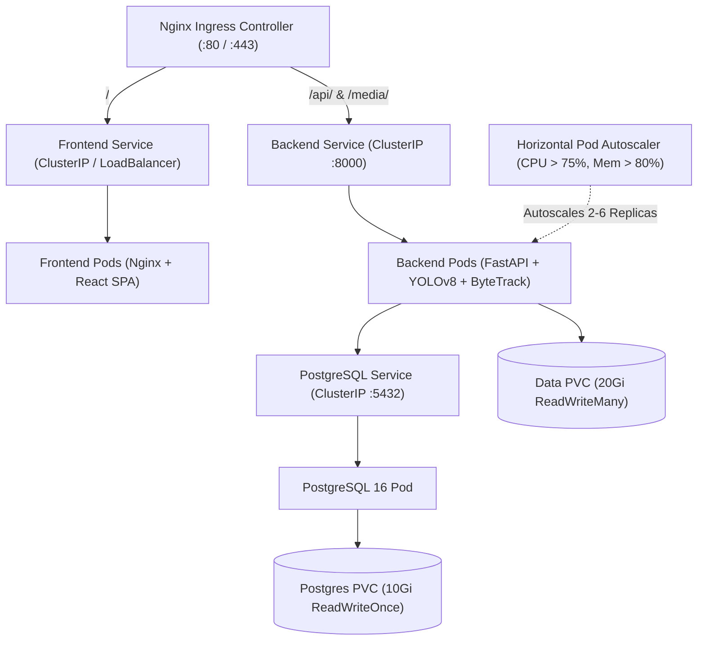

# VisionGuard ?" Kubernetes Deployment Guide

This directory contains the production-grade Kubernetes orchestration manifests for deploying **VisionGuard** with high availability, automated scaling, and persistent storage.

---

## Architecture Topology



---

## 1. Quick Deploy with Kustomize

Deploy the entire VisionGuard stack to your active Kubernetes cluster (Minikube, Kind, GKE, EKS, AKS) in one command:

```bash
# Apply all manifests via Kustomize
kubectl apply -k k8s/

# Or using the automated deploy script:
./k8s/deploy.sh       # Linux / macOS
.\k8s\deploy.ps1      # Windows PowerShell
```

---

## 2. Resource Inventory

| Manifest | Kind | Purpose |
| :--- | :--- | :--- |
| `namespace.yaml` | `Namespace` | Dedicated `visionguard` isolated namespace |
| `configmap.yaml` | `ConfigMap` | Non-sensitive configurations (threads, paths, ports) |
| `secret.yaml` | `Secret` | Database credentials and connection URLs |
| `storage-pvc.yaml` | `PersistentVolumeClaim` | 10Gi for DB state, 20Gi for video uploads & reports |
| `postgres.yaml` | `Deployment`, `Service` | PostgreSQL 16 container with liveness/readiness probes |
| `backend.yaml` | `Deployment`, `Service`, `HPA` | FastAPI inference engine (2 to 6 autoscaled pods) |
| `frontend.yaml` | `Deployment`, `Service` | High-performance Nginx React frontend |
| `ingress.yaml` | `Ingress` | Nginx Ingress with 250MB upload & 300s timeout support |

---

## 3. Local Development with Minikube

```bash
# 1. Start minikube with ingress enabled
minikube start --cpus=4 --memory=8192
minikube addons enable ingress

# 2. Build local images inside Minikube Docker environment
eval $(minikube docker-env)
docker build -t visionguard-backend:latest -f backend/Dockerfile .
docker build -t visionguard-frontend:latest -f frontend/Dockerfile .

# 3. Apply manifests
kubectl apply -k k8s/

# 4. Access the service
minikube service visionguard-frontend -n visionguard
```

---

## 4. Verification & Health Monitoring

```bash
# Inspect all running VisionGuard pods
kubectl get pods -n visionguard -o wide

# Check backend health endpoint
kubectl exec -it deployment/visionguard-backend -n visionguard -- curl http://localhost:8000/api/v1/health

# Tail real-time CV inference logs
kubectl logs -f deployment/visionguard-backend -n visionguard

# Monitor autoscaling metrics
kubectl get hpa -n visionguard
```

